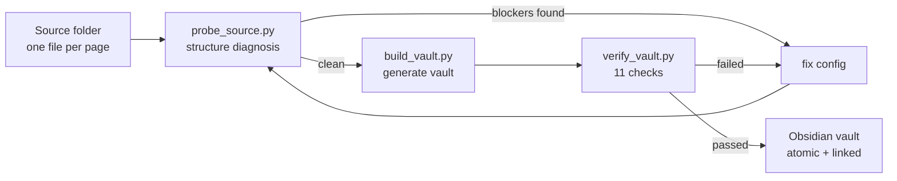

# Notes to Obsidian Vault

**Turn page-based Markdown notes into an Obsidian vault — atomic notes, backlinks, tags, frontmatter — without silently losing content.**

[中文说明](README.zh-CN.md)

---

## The problem

You have a folder of Markdown notes where one file = one page, and each page holds several items. It works, but you can only find things by folder and full-text search.

Splitting it into an Obsidian vault is the obvious upgrade. The problem is that **migration fails silently**:

- A regex misses a heading because the ID contains a space → **2 items vanish**, along with their entire bodies
- A section uses a non-standard bold label → **38 formula symbols** get discarded as "preamble"
- A chapter keyword is a substring of another (`三角函数` contains `函数`) → **an entire batch lands in the wrong chapter**
- The script prints `Done`, exits `0`, and nothing is wrong. Until you count.

Every one of those happened during the migration this skill was extracted from. None raised an error.

So this skill is built around a different idea: **probe first, confirm with the user, verify after.** The parsing is the easy part.

---

## How it works



Three scripts, one shared JSON config. No third-party dependencies.

| Script | When | Output |
|---|---|---|
| `scripts/probe_source.py` | Before building | Structure diagnosis + blocker list |
| `scripts/build_vault.py` | After config is complete | Vault files. `--dry-run` to preview, `--force` to rebuild |
| `scripts/verify_vault.py` | After building | 11 checks, exits `1` on any failure |

---

## Install

This is an [Agent Skill](https://docs.claude.com/en/docs/claude-code/skills) — a `SKILL.md` plus bundled scripts and references. Install it into your agent's skills directory:

```bash
# WorkBuddy
git clone https://github.com/play1216/notes-to-obsidian-vault.git \
  ~/.workbuddy-ai/skills/notes-to-obsidian-vault

# Claude Code
git clone https://github.com/play1216/notes-to-obsidian-vault.git \
  ~/.claude/skills/notes-to-obsidian-vault
```

Or just clone it anywhere and run the scripts directly — they are plain Python 3 and do not import anything from the agent.

---

## Quick start

**1. Copy a profile and fill in two paths.**

```bash
cp references/profiles/math-gaokao.json my-notes.json
```

```json
{
  "source": { "root": "/path/to/your/notes" },
  "vault":  { "path": "/path/to/Obsidian/NewVault" }
}
```

**2. Probe.**

```bash
python scripts/probe_source.py --config my-notes.json
```

It reports four classes of structure problems that lose content, plus tag distribution, chapter coverage and attachment gaps. **Fix every blocker before continuing.**

**3. Build.**

```bash
python scripts/build_vault.py --config my-notes.json --dry-run   # preview stats
python scripts/build_vault.py --config my-notes.json
```

**4. Verify.**

```bash
python scripts/verify_vault.py --config my-notes.json
```

Item sets must match exactly, zero broken links, `$` counts identical per item, zero missing photos. If anything fails, fix the config and rebuild — **do not hand-edit the vault**, the next rebuild will discard your edits.

---

## The four-layer design

Obsidian lets you put anything anywhere, which is exactly why most vaults become a mess. Let four mechanisms do four different jobs, with no overlap:

| Mechanism | Owns | Why |
|---|---|---|
| **Folders** | Chapters (coarse, few, stable) | Only for "walk in and browse", not for retrieval |
| **Backlinks** | Methods | A method note's backlinks become "which items used this move" |
| **Tags** | Concepts (fine, many, hierarchical) | `#concept/series/summation`, search + tag pane |
| **Frontmatter** | Record card (id/date/difficulty/status/photo) | Queries and review scheduling |

```
00 Overview/   index, review queue, stats, how-to, field reference
10 Items/      one item per file, split by chapter, each with a _index note
20 Methods/    parent methods, linked from items
30 Pages/      original pages preserved verbatim, for cross-checking
40 Assets/     originals/ and item-images/
90 Templates/  item template, field reference
```

---

## What's in the box

| Path | Contents |
|---|---|
| `SKILL.md` | Five hard rules, four-layer design, six-step workflow |
| `references/config-schema.md` | Every config field, plus how to write a profile for a new domain |
| `references/pitfalls.md` | **Seven silent-failure case studies** — read before changing any parsing logic |
| `references/profiles/math-gaokao.json` | Verified profile for a 148-item gaokao math problem set |
| `assets/pages/` | Overview page templates with `{{TITLE}}`, `{{ITEMS}}` placeholders |

---

## The seven silent failures

Full write-ups in [`references/pitfalls.md`](references/pitfalls.md). Short version:

| # | Failure | Symptom |
|---|---|---|
| 1 | `\S+` can't match IDs containing spaces/parens | Whole items silently dropped |
| 2 | Non-standard bold labels treated as preamble | A section's body discarded |
| 3 | Chapter keyword is a substring of another chapter's | Whole batch misclassified |
| 4 | Page-level `##` sections glued to the last item | Content bleeds between items |
| 5 | `Path(x).stem` eats dots in IDs | False broken-link reports |
| 6 | Escaped vs bare pipe in wikilinks | Half the links reported broken |
| 7 | Rebuild wipes hand-written pages | Irrecoverable unless stashed |

> #6 in detail: inside a table cell a pipe must be escaped as `\|`, but in normal text it is bare. A link checker has to split on both forms — handle only one and you miss half of them.

The general lesson: **before changing the parser, ask "if this change is wrong, will it raise an error?"** For six of the seven above, the answer was no. That is why `verify_vault.py` compares `$` counts item by item — it is the single most sensitive check for truncated bodies.

---

## Verified

End-to-end on a real 148-item / 78-page problem set:

- **148 = 148** item IDs, exact set match with the source
- **1156 wikilinks**, 0 unresolved
- **0** items with mismatched `$` counts
- **0** missing photo files
- **0** leftover metadata lines in bodies

A fresh build was then diffed against a hand-tuned vault: filenames identical, bodies identical except two intentional wording changes.

---

## Requirements

- Python 3.9+ (no third-party packages)
- Obsidian (obviously)
- Source notes must already be **structured**: a stable heading level per item, `- **Field**: value` metadata lines, and tag lists. This skill migrates structure; it does not invent it.

---

## Not for you if

- Your notes are free-form prose with no consistent heading structure → do a structuring pass first
- You just want to add frontmatter without splitting items → you don't need this; a batch edit will do
- You only have a handful of notes → hand-build it, the verification overhead isn't worth it

---

## License

MIT — see [LICENSE](LICENSE).
