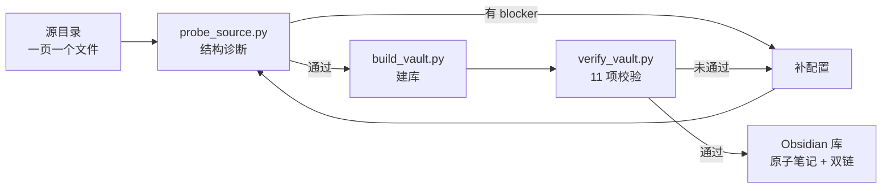

# Notes to Obsidian Vault

**把按页组织的 Markdown 笔记迁移成 Obsidian 独立库 —— 一条一篇、双链挂方法、标签挂知识点、frontmatter 存档案，而且不会悄悄丢内容。**

[English](README.md)

---

## 为什么需要它

你手上有一堆 Markdown 笔记，一个文件 = 一页，一页里有好几条内容。能用，但只能靠文件夹和全文搜索找东西。

拆成 Obsidian 库是显而易见的升级。问题是：**迁移会静默失败**。

- 编号里带空格，正则抓不住 → **2 条内容连同正文整块消失**
- 某一段用了非标准的小标题 → **38 个公式符号**被当作"前言"丢掉
- 章节关键词是另一个章节的子串（`三角函数` 含 `函数`）→ **一整批分错章**
- 脚本打印"完成"，退出码 `0`，一切正常。直到你去数。

上面每一条都真实发生过，没有一条报错。这个 skill 就是从那次迁移里抽出来的。

所以它的重心不在解析，而在：**先探查、再跟用户确认、最后校验。**

---

## 工作流



三个脚本，共用一份 JSON 配置，不依赖任何第三方库。

| 脚本 | 何时跑 | 输出 |
|---|---|---|
| `scripts/probe_source.py` | 建库前 | 结构诊断 + blocker 清单 |
| `scripts/build_vault.py` | 配置补齐后 | 库文件。`--dry-run` 预览，`--force` 重建 |
| `scripts/verify_vault.py` | 建库后 | 11 项校验，任一项失败退出码 `1` |

---

## 安装

这是一个 [Agent Skill](https://docs.claude.com/en/docs/claude-code/skills)：一个 `SKILL.md` 加配套脚本和文档。装到你的 agent 技能目录即可：

```bash
# WorkBuddy
git clone https://github.com/play1216/notes-to-obsidian-vault.git \
  ~/.workbuddy-ai/skills/notes-to-obsidian-vault

# Claude Code
git clone https://github.com/play1216/notes-to-obsidian-vault.git \
  ~/.claude/skills/notes-to-obsidian-vault
```

也可以 clone 到任意位置直接跑脚本——都是纯 Python 3，不 import agent 的任何东西。

---

## 快速开始

**1. 复制一份 profile，填两个路径。**

```bash
cp references/profiles/math-gaokao.json my-notes.json
```

```json
{
  "source": { "root": "/你的/笔记目录" },
  "vault":  { "path": "/你的/Obsidian/新库" }
}
```

**2. 探查。**

```bash
python scripts/probe_source.py --config my-notes.json
```

它会报出四类会丢内容的结构问题，以及标签分布、章节覆盖率、附件缺口。**结论段落里有 blocker 就先修，不要往下走。**

**3. 建库。**

```bash
python scripts/build_vault.py --config my-notes.json --dry-run   # 先看统计
python scripts/build_vault.py --config my-notes.json
```

**4. 校验。**

```bash
python scripts/verify_vault.py --config my-notes.json
```

条目集合必须完全相等，坏链为零，每条公式的 `$` 数量一致，照片不缺。任何一项不过，就回去改配置重建 —— **不要手工改库**，下一次重建会把你的修改丢掉。

---

## 四层分工

Obsidian 什么都能塞，所以最容易变成一团。让四个机制各管一件事，互不重叠：

| 机制 | 管什么 | 为什么 |
|---|---|---|
| **文件夹** | 章节（粗、少、稳定） | 只用来"走进去找"，不承担检索 |
| **双链** | 方法 | 方法页的反链自动变成"这招我用过哪些条" |
| **标签** | 知识点（细、多、层级化） | `#知识点/数列/求和`，靠搜索和标签面板 |
| **frontmatter** | 档案卡（编号/日期/难度/状态/照片） | 给查询和复习排期用 |

```
00 总览/    首页、复习台、统计、怎么用、字段说明
10 题目/    一条一篇，按章节分子文件夹，每章一个 _索引 页
20 方法/    母方法，靠双链挂过来
30 原页/    原页原样保留，翻纸对照用
40 附件/    原图/ 与 条目图/
90 模板/    条目模板、字段说明
```

---

## 目录说明

| 路径 | 内容 |
|---|---|
| `SKILL.md` | 五条铁律、四层分工、六步流程 |
| `references/config-schema.md` | 全部配置字段，以及为新领域写 profile 的流程 |
| `references/pitfalls.md` | **七个静默失败案例**，改解析逻辑前必读 |
| `references/profiles/math-gaokao.json` | 已验证的数学题本配置（148 条） |
| `assets/pages/` | 说明页模板，支持 `{{TITLE}}`、`{{ITEMS}}` 等占位符 |

---

## 七个静默失败

完整记录见 [`references/pitfalls.md`](references/pitfalls.md)，速览：

| # | 失败 | 症状 |
|---|---|---|
| 1 | `\S+` 匹配不了含空格的编号 | 整条内容消失 |
| 2 | 非标准加粗小标题被当前言 | 一段正文被丢弃 |
| 3 | 章节关键词是另一章的子串 | 整批分错章 |
| 4 | 页级 `##` 小节粘到最后一条 | 内容串位 |
| 5 | `Path(x).stem` 吃掉编号里的点 | 坏链误报 |
| 6 | 双链里的 `\|` 与 `|` | 一半链接报错 |
| 7 | 重建冲掉手写页 | 不可恢复 |

一条通用原则：**改解析逻辑前先问自己"这个改动如果错了，会报错吗？"** 上面七条里有六条不会。这就是为什么 `verify_vault.py` 要逐条比对 `$` 数量 —— 它是最灵敏的"正文被截断"探测器。

---

## 验证过的

在一个真实的 148 条 / 78 页题本上端到端跑通：

- **148 = 148** 条编号，与源目录集合完全一致
- **1156 条双链**，0 条未解析
- **0** 条公式 `$` 数量不一致
- **0** 张照片缺失
- **0** 处正文残留元数据

并且把新建的库和手工调优过的库逐文件 diff：文件名完全一致，正文除两处有意的措辞统一外完全一致。

---

## 环境要求

- Python 3.9+（无第三方依赖）
- Obsidian
- 源笔记必须**已经结构化**：每条有稳定的标题层级、`- **字段**：值` 形式的元数据、标签列表。这个 skill 迁移结构，不发明结构。

---

## 不适合的场景

- 笔记是自由散写的长文、没有固定标题层级 → 先做一次结构化识别
- 只想加 frontmatter 不拆条 → 不需要这套，批量改文件头就行
- 只有几条笔记 → 手工建更快，校验成本反而更高

---

## 许可

MIT，见 [LICENSE](LICENSE)。
